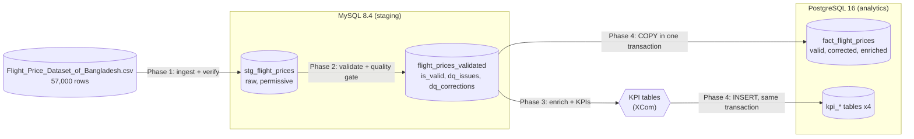

# Flight Price Analysis Pipeline (Apache Airflow)

An end-to-end data pipeline that ingests the **Flight Price Dataset of Bangladesh** (Kaggle, 57,000 bookings), validates and corrects it, computes fare KPIs and loads the results into PostgreSQL for analysis. Orchestrated with **Apache Airflow**, using **MySQL** for staging and **PostgreSQL** for analytics.

**Author:** David Kamanda, AmaliTech training programme

---

## 1. Technologies and exact versions

| Component | Version | Role |
|---|---|---|
| Apache Airflow | 3.1.8 (Docker image `apache/airflow:3.1.8`, Python 3.12) | Orchestration, `LocalExecutor`, `standalone` mode |
| MySQL | 8.4 (`mysql:8.4`) | Staging database (`flight_staging`) |
| PostgreSQL | 16 (`postgres:16`) | Analytics database (`flight_analytics`) and Airflow metadata |
| Python libraries | pandas 2.3.3, MySQL provider 6.5.0, Postgres provider 6.6.0 | See `requirements.txt` (pinned from Airflow's constraints-3.1.8 file) |
| Docker Desktop | with WSL 2 (Windows) | Runs all four containers |

---

## 2. Repository structure

```
flight-price-airflow/
├── README.md                     # this report
├── .gitignore                    # data, logs, .env, IDE folders, caches
├── .env.example                  # password template (copy to .env)
├── docker-compose.yaml           # Airflow 3.1.8 + MySQL 8.4 + PostgreSQL 16 (x2)
├── requirements.txt              # pinned versions inside the Airflow image
├── dags/
│   ├── .airflowignore            # skip flight_utils/ when looking for DAGs
│   ├── flight_price_pipeline.py  # the pipeline DAG (8 tasks)
│   ├── hello_world.py            # practice DAG
│   └── flight_utils/             # config, ingestion, validation, transform, kpis, load, alerts
├── sql/
│   ├── 01_mysql_staging.sql      # MySQL staging table
│   ├── 02_mysql_validated.sql    # MySQL validated table
│   ├── 03_postgres_analytics.sql # PostgreSQL fact + KPI tables
│   ├── kpi_crosscheck.sql        # KPIs in plain SQL (verification)
│   └── test_inject_bad_rows.sql  # test fixture: one bad row per rule
├── data/                         # CSV goes here (not committed)
├── docs/
└── plugins/
```
---
## 3. Architecture



**Design principles**

- **Layers:** raw data stays untouched in staging. Validated data goes to a separate table. Only valid, corrected and enriched data reaches analytics.
- **Flag, never delete:** every row keeps `is_valid`, `dq_issues` and `dq_corrections`, so every decision is traceable (`staging_id` links all layers back to the CSV row).
- **Permissive staging, strict analytics:** MySQL staging accepts NULLs so bad rows can be reported. PostgreSQL enforces `NOT NULL` and `CHECK` constraints as a second line of defence.
- **One place for each setting or formula:** paths, connection IDs, column names, reference data, thresholds and peak seasons live in `dags/flight_utils/config.py`. Total Fare = Base + Tax is applied once (Phase 2).
- **Thin DAG, testable helpers:** the DAG file only lists tasks and their order. The logic lives in the `flight_utils` package, and the KPI and rule functions are pure (no database), so they can be tested with small DataFrames.
- **Idempotent:** every step can be re-run safely (`CREATE TABLE IF NOT EXISTS`, `TRUNCATE` + reload).

---

## 4. Execution flow


Every phase ends with a check, so bad or missing data stops the run before it reaches the next layer.

---

## 5. DAG and tasks

**DAG:** `flight_price_pipeline` (`dags/flight_price_pipeline.py`). Manual schedule (`schedule=None`), `catchup=False`, owner `david`, tag `flight_prices`. The DAG's documentation in the Airflow UI (**Docs**) is the file's docstring (`doc_md=__doc__`).

| # | Task | Phase | What it does | Output (XCom) | Retries |
|---|---|---|---|---|---|
| 1 | `create_staging_table` | 1 | Runs `sql/01_mysql_staging.sql` (`CREATE TABLE IF NOT EXISTS stg_flight_prices`) | none | 1 |
| 2 | `load_csv_to_mysql` | 1 | Reads the CSV, renames columns (`COLUMN_MAP`), rounds decimals, `TRUNCATE`, batch-inserts 5,000 rows per trip | rows loaded (57000) | 1 |
| 3 | `verify_ingestion` | 1 | CSV vs MySQL: all mapped columns exist, row counts equal, 3 fare totals equal (±0.01 BDT) | none (fails on mismatch) | 1 |
| 4 | `validate_data` | 2 | Runs 8 data-quality rules, applies corrections, writes `flight_prices_validated` | validation summary | 1 |
| 5 | `quality_gate` | 2 | Fails if more than 5% of rows are invalid. Logs a WARNING alert if any are invalid. | none | **0** (a data problem does not fix itself) |
| 6 | `compute_kpis` | 3 | Reads valid rows, enriches them (`route`, `season_type`, `departure_month`), computes 4 KPI tables | KPI tables (about 28 KB) | 1 |
| 7 | `load_to_postgres` | 4 | One transaction: create tables, `TRUNCATE`, `COPY` fact rows, `INSERT` KPI rows, `COMMIT` (or `ROLLBACK`) | rows per table, seconds | 1 |
| 8 | `verify_postgres_load` | 4 | MySQL valid rows vs PostgreSQL fact table: count, min/max `staging_id`, 3 fare totals, plus KPI row counts | none (fails on mismatch) | 1 |

**DAG parameter:** `fail_after_copy` (boolean, default `false`, **test only**). It makes `load_to_postgres` fail after the COPY and before COMMIT, to demonstrate the rollback.

**Practice DAG:** `hello_world` (3 tasks), used to learn TaskFlow and XCom and to confirm the CSV is visible inside Airflow.

### Code modules (`dags/flight_utils/`)

| Module | Responsibility |
|---|---|
| `config.py` | Every path, connection ID, table name, column map, reference list and threshold |
| `ingestion.py` | Phase 1: create the staging table, load the CSV, verify the load |
| `validation.py` | Phase 2: rule functions, `validate_dataframe`, saving validated rows, quality gate |
| `transform.py` | Phase 3: read valid rows, `enrich`, `build_kpis` |
| `kpis.py` | Phase 3: 4 pure KPI functions and the `KPI_FUNCTIONS` registry |
| `load.py` | Phase 4: transactional load to PostgreSQL and its verification |
| `alerts.py` | Retry, failure and DAG success/failure alert callbacks |

---

## 6. Data validation (Phase 2)

Each rule is a function returning `{label: mask}`. Rows are labelled, not deleted.

| Rule | Check | Action | Label |
|---|---|---|---|
| Required columns | Airline, Source, Destination, Base Fare, Tax & Surcharge, Total Fare exist | **Fail the DAG** | (error) |
| Missing values | NULL or blank after trimming | Flag | `missing:<column>` |
| Data types | Fares and duration numeric, dates valid, days a whole number | Flag | `bad_type:<column>` |
| Categories | Stopovers, class, booking source and seasonality in an allowed list | Flag | `bad_value:<column>` |
| Negative fares | Base, tax or total below 0 | Flag | `negative_fare:<column>` |
| Invalid cities | Airport code in the reference list (20 airports), name matches the code, source ≠ destination | Flag | `invalid_airport:<column>`, `same_source_destination` |
| Times | Arrival after departure | Flag | `bad_times` |
| Total fare | Total = Base + Tax (±1 BDT) | **Correct**, keeping `total_fare_original` | `total_fare_corrected` / `total_fare_calculated` |

**Quality gate:** 0 invalid rows passes. Up to 5% invalid passes with a `⚠️ ALERT: DATA QUALITY` warning (invalid rows are excluded from KPIs). More than 5% fails the run.

**Result on the real data:** 57,000 rows, **57,000 valid**, **2,522 totals corrected**. The dataset has no nulls, negative fares, invalid airports or duplicates. Every rule was proven with planted bad rows (`sql/test_inject_bad_rows.sql`; see section 8).

---

## 7. KPIs (Phase 3)

All KPIs use **valid rows only** and the **corrected** `total_fare_bdt`. Peak seasons = **Eid, Hajj, Winter Holidays** (`PEAK_SEASONS` in `config.py`). Non-peak = Regular.

| KPI | Definition | Computation | Table |
|---|---|---|---|
| Average Fare by Airline | Mean total, base and tax fare per airline | `groupby("airline").mean()`, rounded to 2 dp. `fare_rank` (ties share a rank). | `kpi_avg_fare_by_airline` (24 rows) |
| Seasonal Fare Variation | Mean total fare per season type and per season, compared with non-peak | `pct_vs_non_peak = (avg ÷ non-peak avg − 1) × 100` | `kpi_seasonal_fare_variation` (6 rows) |
| Booking Count by Airline | Number of valid bookings per airline | `groupby("airline").size()`, `share_pct`, `booking_rank` | `kpi_bookings_by_airline` (24 rows) |
| Most Popular Routes | Source-destination pairs ranked by bookings | `route = source-destination`, `groupby(route).size()`, `route_rank` | `kpi_popular_routes` (152 rows) |

### Results

| KPI | Result |
|---|---|
| Highest average fare | Turkish Airlines **74,738.63 BDT**. Lowest: Vistara **67,497.63 BDT**. |
| Peak vs non-peak | **81,092.55** vs **67,337.33 BDT**, so peak is **+20.43%** |
| By season | Hajj **+42.85%**, Eid **+34.83%**, Winter Holidays **+17.70%** |
| Most bookings | US-Bangla Airlines **4,496** (7.89%), about 2× any other airline (2,201–2,368) |
| Most popular route | **RJH → SIN, 417 bookings**, then DAC → DXB (413) and BZL → YYZ (410) |

**Cross-check:** the same KPIs computed in plain SQL (`sql/kpi_crosscheck.sql`) match the pandas results exactly (largest difference across all 24 airline averages: 0.00).

---

## 8. Loading into PostgreSQL (Phase 4)

| Goal | How |
|---|---|
| **Minimal latency** | Bulk `COPY ... FROM STDIN` from an in-memory CSV (one stream instead of 57,000 `INSERT`s). KPI tables use one multi-row `INSERT` each (`execute_values`). |
| **Data consistency** | One transaction: `TRUNCATE` + `COPY` + KPI `INSERT`s, then `COMMIT`. Any error triggers `ROLLBACK`, and PostgreSQL keeps the previous complete load (in PostgreSQL, even `TRUNCATE` is transactional). |
| **Verification** | `verify_postgres_load` compares MySQL and PostgreSQL on row count, min/max `staging_id` and 3 fare totals, plus KPI row counts |

All rows of one load share the same `loaded_at`/`computed_at`, because PostgreSQL's `CURRENT_TIMESTAMP` is the transaction start time. That is visible proof of a single transaction.

**Tables:** `fact_flight_prices` (57,000 rows, `staging_id` primary key, `NOT NULL` everywhere, `CHECK` fares ≥ 0, `CHECK` season_type, indexes on airline, route and season_type) and the 4 `kpi_*` tables.

---

## 9. Alerts, testing and evidence

**Alerts** (`flight_utils/alerts.py`): every task retries once after 30 seconds. Callbacks write `⚠️ ALERT: TASK WILL BE RETRIED`, `🚨 ALERT: TASK FAILED`, `✅ ALERT: DAG RUN SUCCEEDED` and `🚨 ALERT: DAG RUN FAILED`. Task alerts appear in the task log. DAG alerts appear in `logs/dag_processor/<date>/dags-folder/flight_price_pipeline.py.log`. Search for `ALERT`.

| Test | How to run | Expected result |
|---|---|---|
| Ingestion check | Delete 10 staging rows, then Clear `verify_ingestion` | Fails: `MySQL 56990` plus 3 sum mismatches |
| Every validation rule | Run `sql/test_inject_bad_rows.sql`, then Clear `validate_data` (with downstream) | 8 planted rows: 7 invalid (one per rule), 1 total calculated. Gate passes with a warning. |
| Quality gate | Set 3,000 rows to class `Premium`, then Clear `validate_data` | Gate fails at 5.27% (> 5%), with no retry |
| KPI formulas | 3-row DataFrame test (see `kpis.py` docstrings) | Matches the hand calculation (A = 200, peak −42.86%) |
| KPI cross-check | `sql/kpi_crosscheck.sql` | Same numbers as pandas |
| Load verification | Delete 5 rows in PostgreSQL, then Clear `verify_postgres_load` | Fails: `56995`, `min staging_id 6` |
| Rollback | Trigger with `fail_after_copy = true` | Load fails twice, PostgreSQL keeps 57,000 rows and the same `loaded_at` |

**Undo any test:** trigger the full DAG (the CSV reload rebuilds every layer).

---

## 10. Challenges and resolutions

| Challenge | Resolution |
|---|---|
| Airflow does not run natively on Windows | Docker Desktop + WSL 2, with Airflow, MySQL and both Postgres instances in one `docker-compose.yaml` |
| Port clashes with locally installed databases | Mapped MySQL to 3307 and PostgreSQL to 5433 on Windows |
| `docker compose up` failed with "cannot find dockerDesktopLinuxEngine" | Docker Desktop was closed. Learned that `config` validates without the engine but `up` needs it. |
| Passwords must not be committed | `.env` (git-ignored) plus `.env.example`. Connections defined as `AIRFLOW_CONN_*` variables. |
| CSV headers contain spaces and symbols | `COLUMN_MAP` in `config.py` renames them to snake_case in one place |
| Float vs `DECIMAL` rounding | Rounded to 2 dp in pandas before loading. Compared totals with a 0.01 BDT tolerance. |
| `IndentationError` and empty files (unsaved) broke DAG imports | Used `airflow dags list-import-errors` to find the file and line. Other DAGs kept running meanwhile. |
| 2,522 rows with Total = 1.2 × (Base + Tax), inflating the grand total by 38,903,704.75 BDT (≈ 0.96%) | Corrected to the assignment's formula, kept the original value, flagged the rows and kept them valid |
| Clean data cannot prove the rules work | Planted one bad row per rule (`test_inject_bad_rows.sql`) |
| Running the drill twice created duplicates, which no rule caught | Found that duplicates are not detected. The source has none, so this is documented as a next step. |
| DataFrames cannot travel through XCom, and XCom is for small data | KPI tables are sent as lists of dicts (about 28 KB). The 57,000 rows are re-read from MySQL with the same `enrich` function. |
| A partially loaded analytics table would mislead users | A single PostgreSQL transaction. Proven with the `fail_after_copy` switch. |
| Every row had the same `loaded_at` | Not a bug: `CURRENT_TIMESTAMP` is the transaction start time, which is evidence of one transaction |

---

## 11. Limitations and next steps

- Add a `duplicate_row` validation rule.
- Schedule the DAG (e.g. daily) when the source is refreshed.
- Add email or Slack notifications to the alert callbacks.
- Move the in-container tests into a `pytest` suite.
- `SIMPLE_AUTH_MANAGER_ALL_ADMINS` (no login) is for local development only.

---

## 12. How to run (Windows)

**Prerequisites:** Docker Desktop (WSL 2) running, Git, and the CSV from Kaggle ("Flight Price Dataset of Bangladesh").

```powershell
git clone <your-repo-url> flight-price-airflow
cd flight-price-airflow
Copy-Item .env.example .env        # then set the 4 passwords in .env (notepad .env)
# Put Flight_Price_Dataset_of_Bangladesh.csv in the data\ folder
docker compose up -d               # first start downloads the images
docker compose ps                  # 4 containers Up; mysql and both postgres (healthy)
```

1. Open **http://localhost:8080** (no login in local mode).
2. Open **flight_price_pipeline**, switch the toggle **on**, then click **Trigger** (leave `fail_after_copy` off).
3. Expect **8 green tasks** in 1–2 minutes.

**Check the results:**

```powershell
docker compose exec postgres-analytics psql -U analytics_user -d flight_analytics -c "SELECT * FROM kpi_seasonal_fare_variation"
docker compose exec postgres-analytics psql -U analytics_user -d flight_analytics -c "SELECT * FROM kpi_popular_routes ORDER BY route_rank LIMIT 10"
```

**Stop:** `docker compose down` (keeps the data) or `docker compose down -v` (deletes the data).


---

## 13. Deliverables

| Deliverable | Where |
|---|---|
| Data ingestion (CSV → MySQL staging, validated insert) | `dags/flight_utils/ingestion.py`, `sql/01_mysql_staging.sql`, tasks 1–3 |
| Data validation | `dags/flight_utils/validation.py`, `sql/02_mysql_validated.sql`, tasks 4–5 |
| Transformation and KPIs | `dags/flight_utils/transform.py`, `dags/flight_utils/kpis.py`, task 6 |
| Load into PostgreSQL | `dags/flight_utils/load.py`, `sql/03_postgres_analytics.sql`, tasks 7–8 |
| Orchestration | `dags/flight_price_pipeline.py`, `docker-compose.yaml` |
| Documentation report | This `README.md` (sections 2–9) |